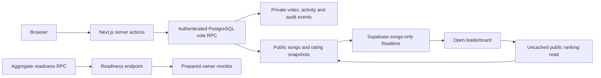

# Musicale interview demo

The current public URL is https://musicale.alexyoon.com. Public release acceptance is pending: the October 16 read-only check found database health ready but Today unavailable. Use the verified local candidate to demonstrate implementation until the hosted gates pass.

Musicale gives everyone the same two recordings each UTC day. Listen through official providers, sign in by email, save one permanent daily choice, see results and return to build a streak. Votes build an auditable Elo ranking; the owner curates songs and future matchups. It hosts no audio and does not personalize voting pairs.

## Local walkthrough

Use [README setup](../README.md#local-setup) for a fresh isolated backend. Automated fixtures write to their local database; run full verification in a disposable project rather than a database containing manual participation you want to preserve. The prepared Phase 7 session uses app **http://127.0.0.1:3200** and Mailpit **http://127.0.0.1:57324**, with the separate `musicale-phase6` backend. These URLs work on the Windows computer running the project, not a remote phone.

1. Open Home while signed out. Explain the shared daily discovery loop, midnight UTC, initial/provisional/tied Elo and official external listening.
2. Open Today, listen on the provider pages, and request a local magic link using a new address such as `phase7-listener@example.test`. In the local catcher, open that address's newest message; copy/open its link in the same app browser. No real inbox is needed locally.
3. Make a genuine listener choice. Both vote controls lock while pending; the saved pick, side totals, streak and next reset appear. Reload, inspect Profile, change its display name, and copy/share the canonical spoiler-free result.
4. Open Leaderboard in a second signed-out browser window. Submit a vote with another local account and observe actual push delivery without refreshing. Inspect mobile vote count/win rate/movement, filtering and song rating data.
5. For editorial tools, sign in locally as the prepared `phase7-owner@example.test` and use the local catcher. Import the disabled test entry from [Phase 5's owner checklist](PHASE_5.md#owner-test-import), edit it, schedule/replace/cancel a day forty-five days ahead, inspect the buffer/variety/audit, and restore any changed settings. Production owner credentials are never part of a public demo.
6. Show the named tests and run `npm run test:restore` after the browser suite has created vote/Auth records. Explain the difference between reconstructing derived rankings and restoring source rows/accounts from a private logical export. Show only aggregate pass results, never the dump or tokens.

## Architecture

PostgreSQL owns eligibility, uniqueness, Elo and streak updates in one transaction. The browser never calculates authoritative ratings. Public page loads retain tagged caching; live notification refresh uses the uncached authoritative path. Public cumulative values may permit inference about today's voting, while the direct daily-result RPC withholds counts until that account votes.

See [claim mapping](CLAIM_EVIDENCE.md), [Phase 3](PHASE_3.md), [Phase 4](PHASE_4.md), [Phase 5](PHASE_5.md) and [Phase 6](PHASE_6.md) for reproducible evidence and its limits. See [BETA.md](BETA.md) for the actual hosted acceptance record; an empty record is not a passed beta.
