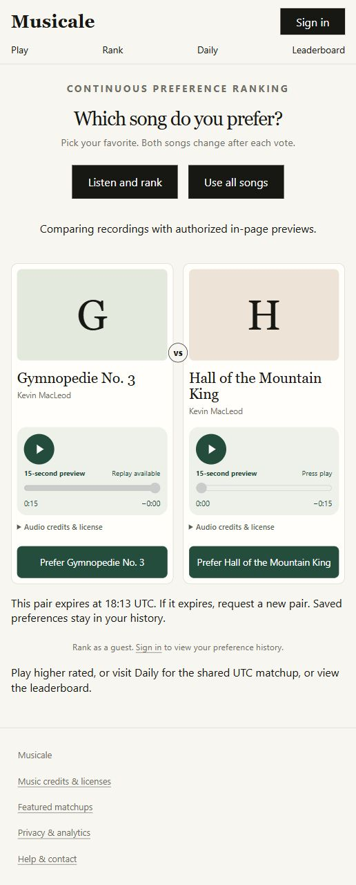

# Production publication — October 17, 2026

The integrated application is published at [musicale.alexyoon.com](https://musicale.alexyoon.com). Application commit `53264ccc3724764519300c10f407bd0b5011aee9` is on remote `main`; Vercel deployment `BFZHDQHKTsAjGTALgeAYnF9L3P1j` is Ready and serves the canonical domain. The subsequent rollout-evidence commit changes documentation and screenshots only. This publication supersedes the older “hosted rollout pending” observations; it does not complete the outstanding acceptance/beta work.

## Database and content

- Inspected the production starting history (`0001`–`0007`) and saved a private, encrypted application/schema snapshot before changes. DPAPI decryption and byte equality were verified. This is a local application snapshot, not a full Auth credential backup or off-site disaster-recovery backup.
- Applied canonical migrations `0008`–`0016` together in one transaction, guarded against an unexpected starting history. The migration connector failed before execution, so the reviewed batch ran through the authenticated project SQL editor. A separate connector read confirmed all sixteen canonical versions and no extra migration record.
- Compared every pre-existing field of all twenty song rows and twenty provider rows against the snapshot: unchanged. The four-recording import separately asserted preservation of all original song rows within its transaction. Existing identities and vote history were retained; no reset occurred.
- Added the four recordings already reviewed in the repository manifest. Reused `validateSong`, exact recording matching and `discoverPreviews` against live Commons metadata, including pinned provenance and license checks. All four sources are available and authorized, using the existing committed `/audio/*.mp3` assets. Trusted setup records the user's existing confirmed secondary account as reviewer without granting it administrator access. Catalog count is now **24**, with **4** authorized previews. The original **20** commercial tracks still have **0** authorized previews and retain external listening links.
- Filled empty schedule dates with the existing curated editorial pairs: October 17 through November 16 UTC, preserving occupied dates. Today is playable and the next thirty days are covered. Bootstrap scheduling has no app administrator actor; the private setup evidence records its trusted execution.
- Confirmed `supabase_realtime` publishes only `public.songs`. The security advisor returned no ERROR findings; the inherited mutable search path on `set_updated_at` remains a WARN. Intentionally callable, authorization-checked RPCs and intentionally denied direct-table access also generate advisor notices. See [search-path guidance](https://supabase.com/docs/guides/database/database-linter?lint=0011_function_search_path_mutable).

No synthetic preferences, votes, rating changes or scores were inserted. At verification there were zero Daily votes and zero Rank votes. Consequently **Play cannot yet issue an eligible untied pair**: genuine Rank/Daily participation must first establish ratings for enough songs. Rank and Daily are available to collect those preferences. Do not seed fake production activity to make Play appear populated.

## Authentication rollout

- Enabled anonymous sign-ins and manual identity linking for the implemented guest flow, retaining email confirmation and normal signup limits.
- Kept the canonical Site URL and existing `/api/auth/callback` allowlist entry; added only the exact production `/api/auth/guest-confirm` URL.
- Verified the new application and `/auth/confirm` were deployed before updating both Confirm sign up and Magic link email bodies to the checked-in token-hash template. Saved their previous bodies privately and verified the replacements persisted after reload. SMTP settings were not changed.
- A fresh browser successfully created a guest session and obtained a private, preview-only Rank comparison. The smoke session created one real anonymous Auth record and one pending comparison, without casting a vote. A Play readiness check may also leave a paused, zero-score run belonging to that guest.
- The designated owner email has no Auth account yet; no administrator role was assigned to another account. Owner sign-in/role provisioning remains unfinished. Real inbox confirmation, the original phone/browser failure scenario, account upgrades and signed-in persistence still need hosted human acceptance.

## Verification

| Check                        | Result                                                                                                                                                                                              |
| ---------------------------- | --------------------------------------------------------------------------------------------------------------------------------------------------------------------------------------------------- |
| Vercel production build      | Ready; source `main` at `53264cc` verified in the dashboard and commit status                                                                                                                       |
| Public pages                 | HTTP 200 for Home, Play, Rank, Daily, Leaderboard, Archive, Help, Privacy, Login, confirmation and a new recording's song page                                                                      |
| Database health              | `/api/health`: HTTP 200, `ready`                                                                                                                                                                    |
| Schedule readiness           | `/api/readiness`: HTTP 200, `ready`, today playable, 30 buffer days                                                                                                                                 |
| Preview delivery             | All four exact asset URLs return HTTP 200 with `audio/mpeg`                                                                                                                                         |
| Production player            | Guest Rank renders two authorized players; actual source decoding/playback reaches 0:15 and stops with replay available. Replay starts again; starting the other song pauses the first              |
| Production voting            | Deliberately not exercised with fabricated choices; zero Daily/Rank votes at verification                                                                                                           |
| Existing regression baseline | 35 unit, 93 database and 100 successful browser cases; production build, TypeScript and zero-vulnerability audit passed during integration; see [scope and environment limits](INTEGRATION.md)      |
| Fresh main CI                | [Verify Musicale run](https://github.com/yoonalexander/musicale/actions/runs/39054789914) was still running the full verification stage at publication; its final result must be checked separately |

## Follow-up boundaries

Continue the existing issue list: genuine ratings for Play, owner sign-in/admin access, real email and account-upgrade acceptance, hosted multi-browser voting/Realtime acceptance, operational alerts and encrypted off-site recovery, genuine beta participation, and commercial preview permissions. Guest abuse protection/retention and ongoing editorial replenishment still need operational acceptance. Publishing the integrated app does not close those gates. See [Phase 2](PHASE_2.md), [operations](OPERATIONS.md), [release acceptance](PHASE_7.md), [beta](BETA.md), and [audio coverage](AUDIO_PREVIEWS.md).
